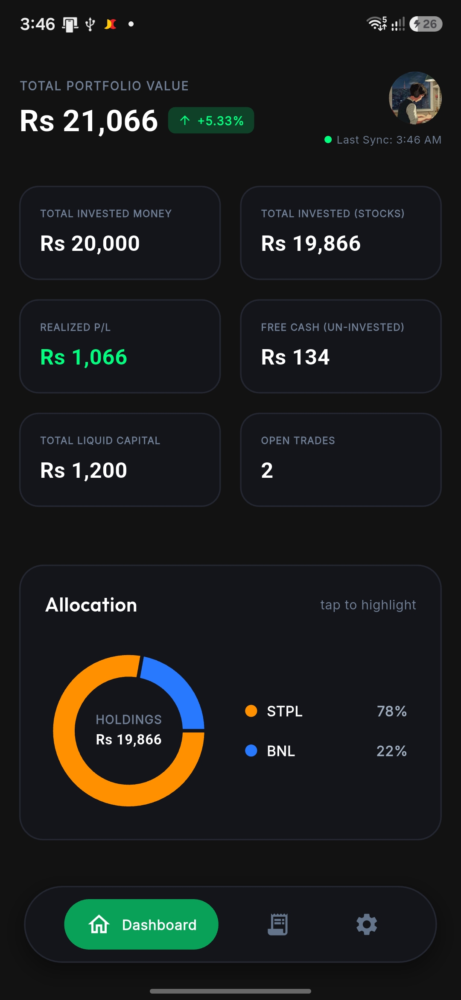
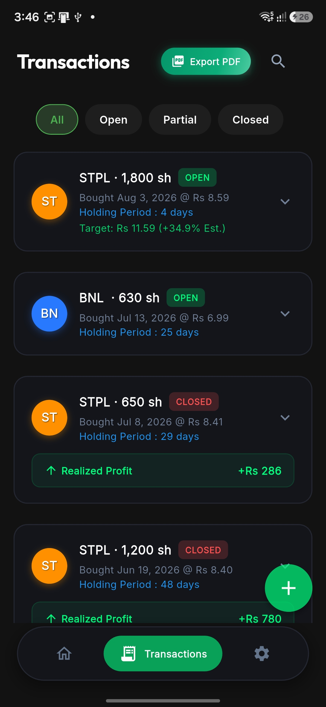
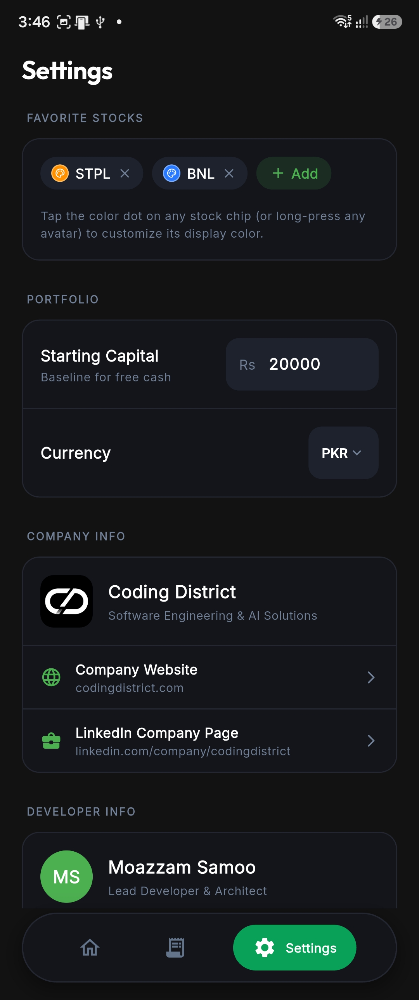
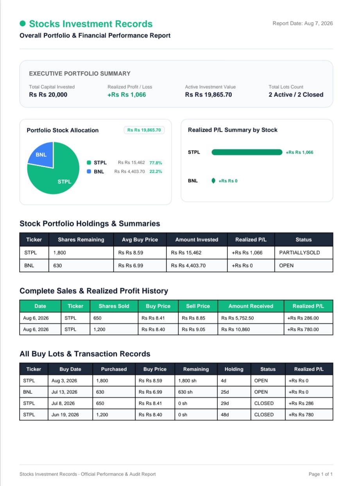
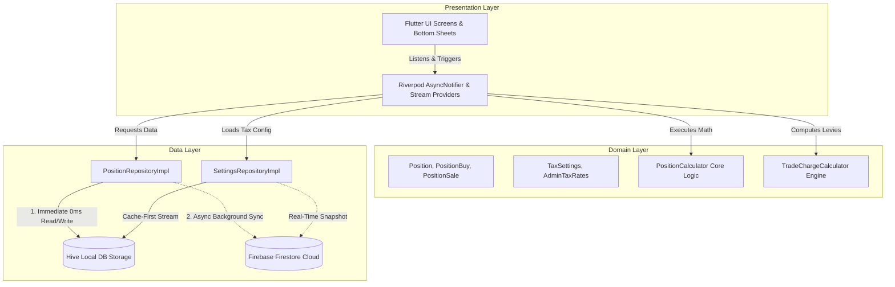

<div align="center">

  

  # Stock Book
  **The Next-Gen, Offline-First PSX Stock Investment & Portfolio Tracking App**
  *Live Pakistan Stock Exchange (PSX) Market Prices • Automated Same-Day Trade Consolidation • PSX Broker Taxes & CGT Deduction • Trailing Alerts*

  [](https://flutter.dev)
  [](https://dart.dev)
  [](https://firebase.google.com)
  [](https://riverpod.dev)
  [](https://pub.dev/packages/hive)
  [](test/)
  [](LICENSE)

  ---

  <a href="#-app-showcase--screenshots">Showcase</a> •
  <a href="#-key-features">Key Features</a> •
  <a href="#-same-day-trade-consolidation-v-trade-standard">Intraday Consolidation</a> •
  <a href="#-psx-brokerage-taxes--charges-system">PSX Taxes & Charges</a> •
  <a href="#-recent-commit-history--release-changelog">Changelog</a> •
  <a href="#-architecture--offline-first-data-flow">Architecture</a> •
  <a href="#-getting-started--local-development">Getting Started</a> •
  <a href="#-project-structure">Project Structure</a>

</div>

<br/>

---

## 📱 App Showcase & Screenshots

<div align="center">

| 📊 Portfolio Dashboard | 🎯 Position & Trades | 📝 Broker & Tax Settings | 📄 PDF Statement Export |
| :---: | :---: | :---: | :---: |
|  |  |  |  |

</div>

---

## ⚡ Key Features

### 💎 Core Capabilities

- 📊 **Real-Time Portfolio Overview & Compact Analytics**
  - Instant calculations for **Total Portfolio Value**, **Starting Capital**, **Currently Invested**, **Free Cash**, **Total Liquid Capital**, and **Realized Profit & Loss**.
  - Formatter supporting Lakh (`L`), Crore (`Cr`), Billion (`B`), and Trillion (`T`) compact figures for ultra-clean display.
  - Interactive asset allocation donut charts powered by `fl_chart`.

- ⚡ **Zero-Latency Offline-First Architecture**
  - Full CRUD operations work **100% offline** with immediate local persistence via **Hive DB**.
  - Background synchronization persists transactions to **Firebase Firestore** with built-in timeout protection.
  - Startup theme caching guarantees immediate Dark/Light mode resolution with **zero UI flicker**.

- 🔄 **Same-Day Trade Consolidation (V-Trade / Floret Capitals Standard)**
  - Automatically merges multiple intraday buys and sales on the same calendar day into a single unified position lot.
  - Volume-weighted average buy price ($\bar{P}_{\text{buy}}$) and session average sell price ($\bar{P}_{\text{sell}}$).
  - High-precision execution timestamps (`MMM d, y • h:mm a`) with full wall-clock time on every trade execution.

- 🧾 **PSX Brokerage Taxes, Regulatory Charges & CGT Engine**
  - Full support for official PSX fee schedules: Broker Commission, SST (Sindh Sales Tax), CDC, NCCPL, SECP, and PSX Laga fees.
  - Capital Gains Tax (CGT) deduction for Active Tax Filers (15%) and Non-Filers (30%) on net profits.
  - Dedicated configuration screen (`BrokerTaxSettingsScreen`) with granular switches and custom broker rates.

- 💹 **Live PSX Market Prices & Trailing Alerts**
  - Real PSX market price feeds via scheduled GitHub Actions Python scraper across 1,000+ listed equities.
  - Trailing push notifications for buy-target and sell-target price thresholds powered by FCM and local notifications.
  - Market status detection with live pulsing indicators (Market Open vs Market Closed).

- 💰 **Profit Withdrawals & Cash-Out Tracking**
  - Dedicated Profit Withdrawals screen (`/withdrawals`) to record and monitor realized profit cash-outs.
  - Financial mathematics that preserve accurate free cash and starting capital balances while updating liquid capital.

- 📄 **High-Resolution PDF Statement & Report Engine**
  - Export comprehensive multi-buy portfolio statements, single-stock holding histories, and dedicated profit withdrawal reports.

- 🎨 **Adaptive Modern Design**
  - Sleek Dark (`#0F172A`) and Light themes with emerald green accents (`#00E676`).
  - Typography powered by Google's **Outfit** and **Inter** font families, micro-interactions with `flutter_animate`, and haptic feedback.

---

## 🔄 Same-Day Trade Consolidation (V-Trade Standard)

In standard Pakistani brokerage apps (such as **V-Trade / Floret Capitals**), purchasing and selling batches of the same equity throughout a single trading session is managed as **one consolidated day lot** rather than separate fragmented records.

### 📐 Mathematical Formulation

For multiple buy executions $i \in \{1 \dots n\}$ and sale executions $j \in \{1 \dots m\}$ of ticker $T$ on calendar date $D$:

1. **Session Total Deployed Capital & Shares Purchased**:
   $$\text{Shares}_{\text{buy}} = \sum_{i=1}^n Q_i^{\text{buy}}, \quad \text{Cost}_{\text{buy}} = \sum_{i=1}^n \left( Q_i^{\text{buy}} \times P_i^{\text{buy}} \right)$$

2. **Session Weighted Average Buy Price**:
   $$\bar{P}_{\text{buy}} = \frac{\text{Cost}_{\text{buy}}}{\text{Shares}_{\text{buy}}}$$

3. **Session Total Proceeds & Shares Sold**:
   $$\text{Shares}_{\text{sold}} = \sum_{j=1}^m Q_j^{\text{sell}}, \quad \text{Proceeds}_{\text{sell}} = \sum_{j=1}^m \left( Q_j^{\text{sell}} \times P_j^{\text{sell}} \right)$$

4. **Session Average Sell Price**:
   $$\bar{P}_{\text{sell}} = \frac{\text{Proceeds}_{\text{sell}}}{\text{Shares}_{\text{sold}}}$$

5. **Consolidated Realized Profit / Loss**:
   $$\text{Realized P/L} = \text{Shares}_{\text{sold}} \times \left( \bar{P}_{\text{sell}} - \bar{P}_{\text{buy}} \right)$$

6. **Carried Overnight Holding**:
   $$\text{Shares}_{\text{held}} = \text{Shares}_{\text{buy}} - \text{Shares}_{\text{sold}}, \quad \text{Remaining Cost Basis} = \text{Shares}_{\text{held}} \times \bar{P}_{\text{buy}}$$

### ⚙️ Autonomous Background Reconciliation

- Whenever multiple position documents for the same ticker and calendar date are retrieved from Firestore, [`allPositionsProvider`](lib/presentation/dashboard/providers/dashboard_providers.dart) automatically:
  1. Combines all buy legs and sale legs into the primary position document.
  2. Recomputes session averages and cost bases.
  3. Updates the primary document in Firestore and purges duplicate documents.
- Preserves high-precision wall-clock time on every trade leg (`MMM d, y • h:mm a`), displayed in [`PositionBuyRow`](lib/presentation/transactions/widgets/position_buy_row.dart) and [`PositionSaleRow`](lib/presentation/transactions/widgets/position_sale_row.dart).

---

## 🧾 PSX Brokerage Taxes & Charges System

Stock Book implements an end-to-end tax deduction engine based on real-world Pakistan Stock Exchange trade confirmations ([`psx_charges_taxes.md`](psx_charges_taxes.md)).

### 🏛 Fee Schedule Breakdown

| Charge Code | Name | Calculation Basis | Default Rate | Applies On |
|---|---|---|---|---|
| **Commission** | Broker Commission | Value-based or Fixed per share | Configurable (0.00% default) | Buy & Sell |
| **SST** | Sindh Sales Tax | % of Broker Commission | 13.0% (0 when commission is 0) | Buy & Sell |
| **CDC** | Central Depository Company | **Fixed per share** | **Rs 0.0025 / share** | Buy & Sell |
| **PSX Laga** | PSX Transaction Levy | % of Trade Value | **0.00425%** | Buy & Sell |
| **SECP** | SECP Regulatory Fee | % of Trade Value | **0.0006%** | Buy & Sell |
| **NCCPL** | NCCPL Clearing Fee | % of Trade Value | **0.00418%** | Buy & Sell |
| **OTC** | Other Transaction Charges | PSX + SECP + NCCPL | ~0.00903% | Display Total |
| **CGT** | Capital Gains Tax | % of Net Positive Profit | **15.0% Filer / 30.0% Non-Filer** | Sell Only |

### 🧮 Net Settlement & Profit Formulas

$$\text{BUY Net Settlement} = \text{Trade Value} + \text{Total Buy Levies}$$

$$\text{SELL Net Settlement} = \text{Trade Value} - \text{Total Sell Levies}$$

$$\text{Net Realized P/L} = \text{Gross Profit} - \text{Proportional Buy Levies} - \text{Sell Levies} - \text{CGT}$$

### 🎛 User Configuration & Controls

- **Master Switch**: Toggle *"Deduct Broker Taxes & Charges"* on/off with a single tap in Settings.
- **Dedicated Screen**: Navigate to `/broker-tax-settings` ([`BrokerTaxSettingsScreen`](lib/presentation/settings/screens/broker_tax_settings_screen.dart)) to adjust:
  - Commission model: Percentage vs. Fixed Paisas/Rupees per share.
  - Investor tax status: Active Filer (15% CGT) vs. Non-Filer (30% CGT).
  - Custom overrides for CDC, SST, NCCPL, and regulatory levies.

---

## 🆕 Recent Commit History & Release Changelog

A detailed summary of the latest 4 commits on this repository:

### 1. `f29b9c3` — Auto-Merge Same-Day Trades (V-Trade Standard) & Execution Timestamps
- **Intraday Consolidation Engine**: Implemented `PositionCalculator.consolidateSameDayPositions` and updated `replay()` to group buys and sells executed on the same date into a single position lot.
- **Session Weighted Metrics**: Computes session average buy price and session average sell price matching V-Trade / Floret Capitals broker statements.
- **Execution Timestamps**: Preserves wall-clock time (`TimeOfDay`) across buy and sell entry sheets; displays formatted timestamps (`MMM d, y • h:mm a`) in [`PositionBuyRow`](lib/presentation/transactions/widgets/position_buy_row.dart) and [`PositionSaleRow`](lib/presentation/transactions/widgets/position_sale_row.dart).
- **Background Auto-Reconciliation**: Autonomous consolidation in `allPositionsProvider` merges fragmented Firestore documents into a primary record and deletes duplicates.
- **UI Enhancements**: Added session average buy and sell badges in [`PositionCard`](lib/presentation/transactions/widgets/position_card.dart) headers.
- **Test Coverage**: Added dedicated unit tests in `test/domain/calculator/position_calculator_same_day_test.dart`.

### 2. `02df085` — PSX Broker Charges, Regulatory Levies & CGT Deduction System
- **Tax Calculation Engine**: Created `TradeChargeCalculator` implementing official PSX fee schedules (Commission, SST, CDC, PSX Laga, SECP, NCCPL, CGT).
- **Domain & Persistence**: Created `AdminTaxRates` and `TaxSettings` entities with Firestore sync (`users/{uid}/settings/preferences`) and local Hive caching.
- **Dedicated Settings UI**: Created `BrokerTaxSettingsScreen` with live preview calculations, alongside a one-tap master toggle in `SettingsScreen`.
- **Net Realized P/L Integration**: Deducts charges and CGT dynamically across `AddSellBottomSheet`, `PositionSaleRow`, `PositionCard`, `portfolioSummaryProvider`, and `stockSummariesProvider`.
- **Test Verification**: Added comprehensive unit test suites in `trade_charge_calculator_test.dart` and `position_calculator_tax_test.dart`.

### 3. `938ad14` — Currency Formatter B/T Suffixes, Compact Analytics & Branding Refresh
- **Large Number Suffixes**: Enhanced `AppCurrencyFormatter` with Billion (`B`) and Trillion (`T`) abbreviations for extreme values.
- **Responsive Dashboard Cards**: Streamlined `MetricDetailCard`, `PortfolioHeader`, and `StatCardGrid` to eliminate touch artifact impressions and ensure responsive layout on compact screens.
- **Company Branding**: Updated company and owner profile assets in `CompanyOwnersScreen`.

### 4. `558cf5a` — UI Enhancements, PDF Reports, Profit Withdrawals & Launch Theme Caching
- **Profit Withdrawals Screen**: Built dedicated `WithdrawalListScreen` (`/withdrawals`) with historical transaction list and dedicated PDF statement generation.
- **PDF Engine Overhaul**: Enhanced `PdfReportService` with multi-buy history breakdowns, updated branding, and high-resolution tabular layouts.
- **Workflow Improvements**: Auto-filled remaining held shares in `AddSellBottomSheet`, added closed position preview toggle in `StockDetailScreen`, and replaced capital warning snackbar with a confirmation dialog.
- **Launch Flicker Elimination**: Immediate dark mode resolution from Hive on cold start, plus dark-mode-adapted white logo on splash.

---

## 🛠 Tech Stack & Dependencies

<div align="center">

| Layer | Technology | Usage |
| :--- | :--- | :--- |
| **Framework** |  | Cross-Platform Mobile UI Framework |
| **Language** |  | Type-Safe Client & Calculator Logic |
| **State Management** |  | Reactive State & Dependency Injection |
| **Local Persistence** |  | 0ms Latency NoSQL Storage |
| **Cloud Backend** |  | Cloud Synchronization & User Settings |
| **Push Notifications** |  | Trailing Price Alerts & Notifications |
| **Navigation** |  | Declarative Deep-Link & Shell Routing |
| **Data Visualization** |  | Interactive Portfolio Donut & Line Charts |
| **PDF Reporting** |  | High-Resolution Financial Statements |

</div>

---

## 🏗 Architecture & Offline-First Data Flow

Stock Book is engineered following **Clean Architecture** and **Domain-Driven Design (DDD)**. All business formulas, financial calculations, and tax schedules reside strictly in pure Dart within the domain layer.



### 🔁 Offline Sync & Persistence Pattern

```text
[ User Records Buy / Sell / Settings ] 
                   │
                   ▼
       ┌───────────────────────┐
       │ Write to Hive Local DB│ ⚡ (Instant UI Render - 0ms Latency)
       └───────────┬───────────┘
                   │
                   ├─── (Network Available?)
                   │        ├── YES ──► Write directly to Firebase Firestore
                   │        └── NO  ──► Handled locally via Firestore offline cache
                   ▼
       [ Connection Restored ] ──► Firestore syncs automatically in background
```

---

## 🚀 Getting Started & Local Development

### 📋 Prerequisites
- **Flutter SDK**: `>=3.12.0` (Dart SDK `>=3.12.2`)
- **Android Studio** / **VS Code** with Flutter extensions
- **Firebase CLI** (optional, for cloud configurations)

### 📥 Step-by-Step Installation

1. **Clone the Repository**
   ```bash
   git clone https://github.com/moazzam-samoo/Stock-Book.git
   cd Stock-Book
   ```

2. **Install Dependencies**
   ```bash
   flutter pub get
   ```

3. **Generate Models & Providers (Freezed & Riverpod)**
   ```bash
   dart run build_runner build --delete-conflicting-outputs
   ```

4. **Run Development Server**
   ```bash
   # Run with Dev flavor
   flutter run -t lib/main.dart --flavor dev

   # Run with Production flavor
   flutter run -t lib/main_prod.dart --flavor prod
   ```

5. **Execute Test Suite**
   ```bash
   # Run all domain calculator tests
   flutter test test/domain/calculator/

   # Run entire test suite
   flutter test
   ```

6. **Build Release Artifacts**
   ```bash
   # Android App Bundle (Play Store upload)
   flutter build appbundle --release --flavor prod -t lib/main_prod.dart

   # Standalone APK (sideload / testing)
   flutter build apk --release --flavor prod -t lib/main_prod.dart
   ```

---

## 📁 Project Structure

```text
stock_investment_tracker/
├── 📁 assets/
│   ├── 📁 icon/                   # App launcher icons, logo, dev photos
│   └── 📁 screenshots/            # App showcase mockups
├── 📁 lib/
│   ├── 📁 core/                   # Design Tokens, AppColors, Formatters, Services
│   │   ├── 📁 services/           # PdfReportService, NotificationService
│   │   └── 📁 utils/              # AppCurrencyFormatter, StockColorUtils
│   ├── 📁 data/                   # Data Models (Freezed), Data Sources, Repositories
│   │   ├── 📁 data_sources/       # FirestoreDataSource, HiveDataSource
│   │   ├── 📁 models/             # PositionModel, TaxSettingsModel, UserSettingsModel
│   │   └── 📁 repositories/       # PositionRepositoryImpl, SettingsRepositoryImpl
│   ├── 📁 domain/                 # Business Domain Logic (Pure Dart)
│   │   ├── 📁 calculator/         # PositionCalculator, TradeChargeCalculator
│   │   ├── 📁 entities/           # Position, PositionBuy, PositionSale, TaxSettings
│   │   └── 📁 repositories/       # PositionRepository, SettingsRepository interfaces
│   ├── 📁 presentation/           # Presentation Layer (Riverpod + Flutter UI)
│   │   ├── 📁 auth/               # Google Sign-In & Auth routing
│   │   ├── 📁 common/             # AppScaffold, CustomAppBar, OfflineBanner
│   │   ├── 📁 dashboard/          # Metric cards, Donut chart, Stock detail
│   │   ├── 📁 onboarding/         # 5-page animated introductory guide
│   │   ├── 📁 routing/            # AppRouter (GoRouter shell & deep linking)
│   │   ├── 📁 settings/           # BrokerTaxSettingsScreen, WithdrawalListScreen
│   │   ├── 📁 splash/             # Theme-aware animated splash screen
│   │   └── 📁 transactions/       # PositionCard, AddBuy/AddSell sheets, Buy/Sale rows
│   ├── main.dart                  # Development entrypoint
│   └── main_prod.dart             # Production entrypoint with Crashlytics
├── 📁 test/                       # Unit, Widget, Golden & Tax Verification Tests
├── pubspec.yaml                   # Package dependencies & configuration
├── psx_charges_taxes.md           # Pakistan Stock Exchange fee specifications
└── README.md                      # Project documentation
```

---

## 💡 Code Highlights

<details>
<summary><b>🔥 Click to view: Intraday Session Consolidation Engine</b></summary>

```dart
// Consolidates multiple intraday trades into a unified session lot (V-Trade standard)
static List<Position> consolidateSameDayPositions(List<Position> positions) {
  if (positions.length <= 1) return positions;

  final Map<String, List<Position>> groups = {};
  for (final p in positions) {
    final key = '${p.ticker.trim().toUpperCase()}::${p.openedAt.year}-${p.openedAt.month}-${p.openedAt.day}';
    groups.putIfAbsent(key, () => []).add(p);
  }

  final List<Position> result = [];
  for (final entry in groups.entries) {
    final group = entry.value;
    if (group.length == 1) {
      result.add(group.first);
      continue;
    }

    final primary = group.first;
    final mergedBuys = group.expand((p) => p.buys).toList()..sort((a, b) => a.date.compareTo(b.date));
    final mergedSales = group.expand((p) => p.sales).toList()..sort((a, b) => a.date.compareTo(b.date));

    final totalBuyShares = mergedBuys.fold<int>(0, (sum, b) => sum + b.shares);
    final totalBuyCost = mergedBuys.fold<double>(0.0, (sum, b) => sum + (b.shares * b.pricePerShare));
    final sessionAvgBuy = totalBuyShares > 0 ? (totalBuyCost / totalBuyShares) : 0.0;

    final updatedSales = mergedSales.map((s) => s.copyWith(costBasisAtSale: sessionAvgBuy)).toList();
    final totalSoldShares = updatedSales.fold<int>(0, (sum, s) => sum + s.shares);
    final netRemainingShares = totalBuyShares - totalSoldShares;

    result.add(primary.copyWith(
      buys: mergedBuys,
      sales: updatedSales,
      status: netRemainingShares <= 0 ? PositionStatus.closed : PositionStatus.partiallySold,
    ));
  }
  return result;
}
```

</details>

<details>
<summary><b>🧾 Click to view: PSX Trade Levies & Net Realized P/L Calculation</b></summary>

```dart
// Computes net realized profit/loss after broker commission, CDC, levies, and CGT
static double calculateNetRealizedPL({
  required int sharesSold,
  required double sellPrice,
  required double costBasisPerShare,
  required int totalBuyShares,
  required double buyPricePerShare,
  required EffectiveTaxRates rates,
}) {
  if (!rates.taxEnabled) {
    return _r2(sharesSold * (sellPrice - costBasisPerShare));
  }

  final buyChargesTotal = TradeChargeCalculator.calculateCharges(
    quantity: totalBuyShares,
    pricePerShare: buyPricePerShare,
    rates: rates,
  ).total;

  final proportionalBuyCharges = totalBuyShares > 0
      ? _r2(buyChargesTotal * (sharesSold / totalBuyShares))
      : 0.0;

  final sellCharges = TradeChargeCalculator.calculateCharges(
    quantity: sharesSold,
    pricePerShare: sellPrice,
    rates: rates,
  ).total;

  final grossPL = _r2(sharesSold * (sellPrice - costBasisPerShare));
  final profitBeforeCgt = _r2(grossPL - proportionalBuyCharges - sellCharges);
  final cgt = TradeChargeCalculator.calculateCgt(profitBeforeCgt, rates);

  return _r2(profitBeforeCgt - cgt);
}
```

</details>

---

## 🤝 Contributing

Contributions, issues, and feature requests are welcome!

1. **Fork** the Repository
2. Create your **Feature Branch** (`git checkout -b feature/AmazingFeature`)
3. **Commit** your Changes (`git commit -m 'feat: Add AmazingFeature'`)
4. **Push** to the Branch (`git push origin feature/AmazingFeature`)
5. Open a **Pull Request**

---

<div align="center">

  <b>Designed & Built with ❤️ by Coding District</b>  
  *Moazzam Samoo (Lead Developer) & Kheeraj Das (Developer)*

</div>
